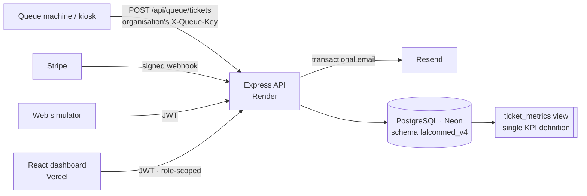

# FalconMed Elite v5.0

**Pharmacy queue performance analytics, from the queue machine to the counter to the network view.**

FalconMed Elite measures how long patients wait and how they are served across a multi-branch outpatient pharmacy network. Every KPI is calculated from real arrival, call and finish timestamps, and each role sees only what it should: the pharmacist their own counter, the manager their branch, the admin the whole network.

It is a **multi-tenant SaaS**: pharmacy groups sign up, start a free trial and subscribe through Stripe, and each organisation only ever sees its own branches, staff, tickets and imports. The demo runs two fictional organisations side by side to prove it. See [docs/MULTI_TENANCY.md](docs/MULTI_TENANCY.md), [docs/SECURITY.md](docs/SECURITY.md), [docs/BILLING.md](docs/BILLING.md) and the [launch checklist](docs/LAUNCH_CHECKLIST.md).

> Built by a hospital pharmacist with 18 years of outpatient and inpatient practice in the UAE, to show how operational pharmacy knowledge translates into a working informatics system.
> This repository runs on a **simulated** network: no real patient data, no patient names.

---

## What it does

| Role | Screen | What they get |
|---|---|---|
| **Pharmacist** | My counter | A working counter console: *Call next* → *Served* / *No-show* (keyboard `N` `S` `X`), the live branch queue, and their own served count, service time and on-time rate vs. yesterday |
| **Branch manager** | Branch performance | Six headline KPIs vs. the previous period, live counters and alerts, arrivals-and-wait by hour, daily trend, pharmacist performance table, service and channel mix |
| **Network admin** | Network overview | Branch scorecard with status bands, on-time ranking, network trends, top pharmacists, drill-down into any branch |
| Manager / admin | Live queue | Real-time waiting list colour-coded against the wait target, counters in service, last-hour pulse, alerts |
| Manager / admin | Queue simulator | Registers arrivals exactly like a kiosk (single, rush of 10, or Poisson auto-arrivals), to test the system end to end |
| **New pharmacy** | Create your organisation | Self-service sign-up with a 14-day free trial; a getting-started checklist (branch → team → data) guides the first visit |
| **Organisation admin** | Settings | Add and edit branches and team members, assign roles and counters, deactivate accounts, reset passwords (temporary password + forced change at first sign-in). Demo records are protected |
| **Organisation admin** | Billing | Plan, usage against plan limits, Stripe Checkout and the Customer Portal (card, invoices, cancel). Trial days carry over when subscribing early |
| **Organisation admin** | Queue keys · Security log · Your data | Per-organisation kiosk keys (revocable, optionally one branch); a log of sign-ins and changes; CSV export of every ticket; delete the organisation and all its data |
| Everyone | My account | Profile and password change; changing it signs out every other device. Forgotten passwords are reset by email link. Optional two-factor sign-in with an authenticator app and recovery codes (organisations can require it for admins) |
| Manager / admin | Import data | Load a CSV export from any queue system. A data-quality report (score, rejected rows with reasons, warnings, privacy guard) appears before anything is saved; every import can be rolled back. See [docs/IMPORT_FORMAT.md](docs/IMPORT_FORMAT.md) |

## Architecture



- **One source of truth.** All metrics read the `ticket_metrics` view: wait = call − arrival, service = finish − call. See [docs/KPI_DEFINITIONS.md](docs/KPI_DEFINITIONS.md).
- **Server-side scoping.** The API decides what a user may see. A pharmacist cannot request another pharmacist's numbers by editing a URL, and no user can reach another organisation's data.
- **Tenant isolation in three layers.** Every query is filtered by the user's organisation; requests naming another organisation's branch or pharmacist are refused (403); and the database itself rejects a user attached to another organisation's branch.
- **Concurrency-safe counters.** `SELECT … FOR UPDATE SKIP LOCKED` guarantees two counters pressing *Call next* together never receive the same patient. A unique partial index allows one open ticket per pharmacist.
- **Honest end of day.** Tickets left open overnight become `abandoned` (left unseen) or `auto_closed` rather than blocking counters or inflating waits.
- **Privacy by design.** No patient names are stored. `patientRef` accepts a de-identified code only, and the importer drops identifier columns (names, phones, Emirates ID) before reading them.
- **Data quality first.** Imported files are validated row by row (impossible sequences, duplicates, future times, outliers) and scored before they can touch a dashboard.

## Tech stack

| Layer | Stack |
|---|---|
| Frontend | React 18, Vite 8, Tailwind CSS, Recharts, React Router 7, lucide icons. Route-level code splitting. |
| Backend | Node 20, Express 4, `pg`, zod validation, JWT + bcrypt, helmet, rate limiting, Stripe, Resend |
| Database | PostgreSQL 16 (Neon). Versioned SQL migrations, check constraints that make invalid ticket states impossible. |
| Testing | 89 end-to-end API tests (`node:test` + supertest) against a real PostgreSQL; GitHub Actions CI |
| Hosting | Vercel + Render + Neon + Cloudflare, all free tier |

## Quick start

```bash
# API
cd backend && npm install && cp .env.example .env   # fill DATABASE_URL, JWT_SECRET (email and Stripe are optional locally)
npm run setup                                       # migrate + 60 days of simulated data
npm run dev                                         # http://localhost:5000

# Dashboard
cd frontend && npm install && cp .env.example .env
npm run dev                                         # http://localhost:5173
```

Demo sign-in: `pharmacist@`, `manager@`, `admin@demo.falconmed.app` with the `DEMO_PASSWORD` you set (default `Demo@2026`).
The full deployment guide is in [docs/DEPLOYMENT_AR.md](docs/DEPLOYMENT_AR.md).

## The simulated network

`npm run seed` does not write random KPI numbers. It **simulates** each day as a multi-counter queue: arrivals follow an outpatient demand curve peaking at 15:00–16:00, staffing varies by hour, service times follow a log-normal distribution per service line, and patients wait for the earliest free counter. Waiting times rise and fall naturally, and branches with tighter staffing land in the *Watch* band. The output is reproducible (seeded RNG): two organisations — *FalconMed Demo Network* (5 UAE branches, 21 pharmacists) and *Oasis Care Pharmacies* (2 Sharjah branches) — each with a *Data Import Lab* sandbox. `npm run seed:refresh` rebuilds it up to today, touching demo organisations only.

## Tests

```bash
cd backend
DATABASE_URL=postgresql://…/a_disposable_db npm test
```

The tests cover: authentication and forged tokens; role scoping (pharmacist / manager / admin boundaries); SQL-injection and invalid-date rejection; KPI reconciliation against raw SQL; staff = pharmacists, with counts summing to the branch; hourly and daily series completeness; no hard-coded metrics on empty periods; kiosk key auth; concurrent *Call next* safety; ownership of ticket closure; live board scoping; end-of-day housekeeping; same-time comparison for periods that include today; importer quality checks, privacy guard, duplicate protection, rollback, and a 50,000-row stress import; tenant isolation (branches, KPIs, live queue, simulator, imports, suspended organisations) and demo refreshes that never touch real organisations; organisation settings (counter clashes, last-admin protection, temporary passwords, session sign-out on password change, protected demo records); self-service sign-up (trial, validation, bot trap, isolation, onboarding progress); per-organisation queue keys (no cross-tenant tickets, branch-scoped and revoked keys); trial and subscription enforcement and plan limits; account lockout; password reset, invitations and email confirmation; Stripe checkout and signed, idempotent webhooks; formula-safe CSV export; organisation deletion; two-factor sign-in (replay protection, recovery codes, reset-link bypass, admin policy, encryption at rest) and database-backed rate limits.

## What v4 changed from v3

| v3 issue | v4 |
|---|---|
| Database credentials committed to a public repo | No secrets in the repository. Config is validated at startup and `.env*` is git-ignored. |
| Staff rankings grouped by **patient name** (no pharmacist on tickets) | Every ticket records `pharmacist_id` and counter |
| Hard-coded and random KPIs (`99.3 %`, `0.7 %`, rating `4.8`, `RANDOM()`) | Every number is derived from timestamps. Empty periods return `null`. |
| Service time defined two different ways | One view, one definition |
| Date filters interpolated into SQL | Parameterised queries with zod-validated input |
| Front-end-only login, passwords in the JS bundle | Server-side JWT auth, bcrypt hashes, login rate limit |
| Pharmacist view showed everyone's last 50 patients | Scoped server-side to the signed-in pharmacist |
| Branch IDs mixed integer/text, branch names inconsistent | Typed foreign keys, one branches table |
| No tests, 635 KB single bundle | 63 API tests, code-split bundle |

## Project structure

```
backend/
  src/config        env validation, pg pool
  src/db            migrations/, migrate.js, seed.js (queue simulation)
  src/lib           http errors, scope + date-range rules, plans, audit log, email, hashed tokens
  src/middleware    JWT auth, roles, plan entitlement, organisation queue keys
  src/services      metrics.js (all KPI SQL), queue.js (ticket workflow, alerts, housekeeping), importer.js (CSV quality checks), billing.js (Stripe)
  scripts/          make-samples.js (importer sample files)
  src/routes        auth, metrics, queue, branches, imports, org, billing
  test/             end-to-end API tests
frontend/
  src/lib           api client, auth context, polling hook, formatting
  src/components    shell, KPI cards, charts, live board, staff table
  src/pages         Login, Signup, Pharmacist, Manager, Admin, LiveQueue, Simulator, Import, Settings, Billing, Legal
  public/samples    importer template and sample files
docs/               KPI definitions, import format, multi-tenancy, security, billing, launch checklist, deployment guide
render.yaml         Render blueprint for the API
.github/workflows   CI: API tests against PostgreSQL, dashboard build
```
