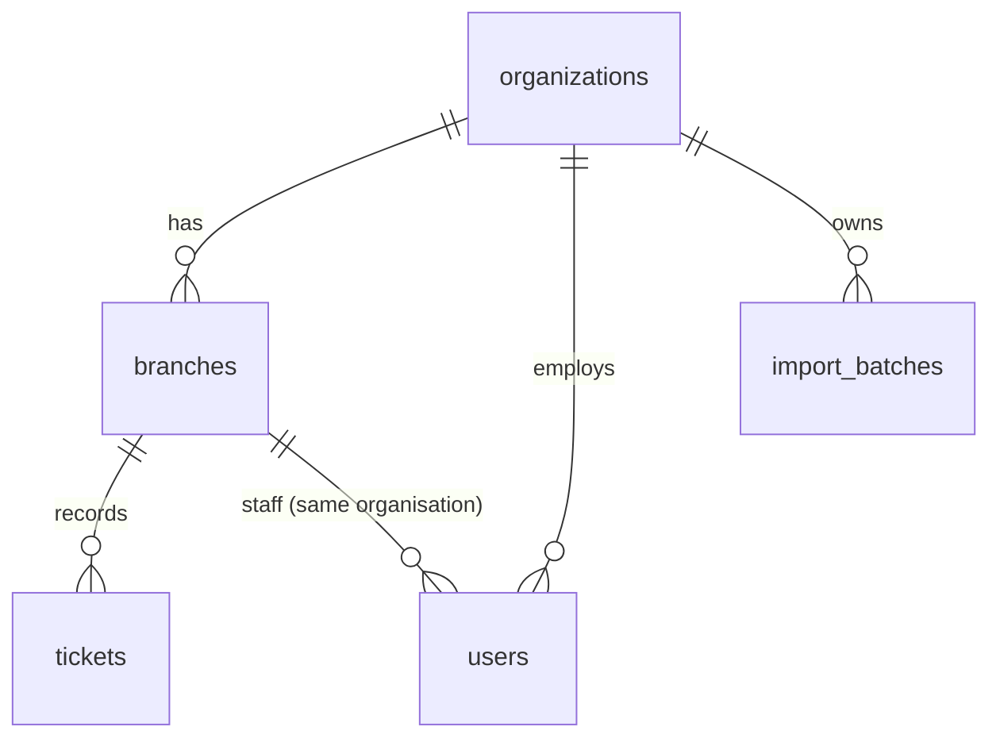

# Multi-tenancy (organisations)

Since v4.4 one FalconMed deployment can serve several pharmacy groups. Each group is an **organisation**, and everything else hangs off it.

| Table | Organisation link |
|---|---|
| `organizations` | `id`, `name`, `slug`, `plan` (`demo` · `trial` · `starter` · `pro` · `enterprise`), `is_active` |
| `branches` | `org_id` (required) |
| `users` | `org_id` (required). A user's branch must be in the same organisation — enforced by a composite foreign key `(branch_id, org_id) → branches(id, org_id)` |
| `import_batches` | `org_id` (required) |
| `tickets` | through their branch (no extra column, so no extra write cost on the hot path) |

## How isolation is enforced

1. **Every query is filtered on the server.** The signed-in user's `org_id` is loaded from the database on every request (not trusted from the browser). `resolveScope()` puts it in every scope, and the shared `where()` builder always adds `branch_id IN (branches of this organisation)`. Branch lists, the staff table, the branch scorecard, the live board, the importer's branch and pharmacist lookup, import history and rollback all filter by organisation.
2. **Naming another organisation's branch or pharmacist is refused** with 403 (`assertInOrg`), rather than silently returning empty numbers.
3. **The database rejects cross-organisation links** (composite foreign key above).
4. **Suspending an organisation** (`is_active = false`) signs its users out on their next request and blocks sign-in. Other organisations are unaffected.

5. **Queue machines use the organisation's own keys.** A kiosk key belongs to one organisation (and optionally one branch) and is refused for any other. Before v5 a single shared key could register tickets in any organisation's branch; it now reaches demo organisations only.

All of this is covered by `backend/test/tenancy.test.js` and `backend/test/saas.test.js`.

## Demo organisations

| Organisation | Plan | Branches | Admin sign-in |
|---|---|---|---|
| FalconMed Demo Network | `demo` | 5 + Data Import Lab | `admin@demo.falconmed.app` |
| Oasis Care Pharmacies | `demo` | 2 + Data Import Lab | `admin@oasis.demo.falconmed.app` |

`npm run seed:refresh` and `DEMO_AUTO_REFRESH=true` rebuild **only** organisations whose plan is `demo`. Real organisations are never deleted or changed by the seed script.

## Upgrading from v4.3

Migration `003_organizations.sql` runs automatically on start-up. It creates the `FalconMed Demo Network` organisation and moves every existing branch, user and import into it. No ticket is changed or lost. The second demo organisation appears after the next `npm run seed:refresh` (or automatically on Render with `DEMO_AUTO_REFRESH=true`).

## Not yet included (next stages)

- One queue-machine key per organisation (today `QUEUE_API_KEY` is shared; tickets still land only in the branch named in the request).
- Billing per plan.

## Organisation settings (v4.5)

Organisation admins open **Settings** to manage their own organisation (API: `/api/org`, admin only, always limited to the admin's organisation):

| Rule | Why |
|---|---|
| New accounts get a temporary password and must choose their own at first sign-in (`PASSWORD_CHANGE_REQUIRED` until then) | The admin never knows a user's real password |
| Changing or resetting a password raises the user's `token_version`, which signs out every older session | A lost or shared device stops working at once |
| One active pharmacist per counter; counters 1…branch.counters | The counter console and *Call next* rely on it (also a unique index in the database) |
| A branch with active staff cannot be deactivated; counters cannot be reduced below an occupied counter | Nobody is left assigned to something that no longer exists |
| A pharmacist serving a patient cannot be moved or deactivated until the ticket is closed | No orphaned open tickets |
| Every organisation keeps at least one active admin; admins cannot deactivate or demote themselves | No organisation can lock itself out |
| In `demo` organisations the seeded branches and accounts are protected; visitor additions are editable and removed at the next demo refresh | The public demo keeps working for everyone |

## Self-service sign-up (v4.6)

`POST /api/auth/signup` `{ organisationName, fullName, email, password, acceptTerms }` creates an organisation (`plan = 'trial'`, `trial_ends_at = now + 14 days`, `created_via = 'signup'`) and its first admin, and signs the admin in.

- **Validation:** platform-wide unique email, password rules, explicit consent not to upload patient identifiers.
- **Abuse protection:** 5 new organisations per IP per hour (failed attempts do not count) and a hidden honeypot field.
- **Readable organisation ID:** a slug from the name (`al-noor-pharmacy`), with a short suffix if taken.
- **First visit:** a getting-started checklist on the network overview (first branch → team → data) driven by `GET /api/org` → `setup`.
- **Trial banner:** trial organisations see the days left; demo organisations keep the demo notice; paid plans see neither.

Not yet: e-mail verification and password-reset e-mails (need an e-mail provider — stage 7), and what happens when a trial ends (billing — stage 6). Today an ended trial shows a banner; nothing is locked or deleted.
